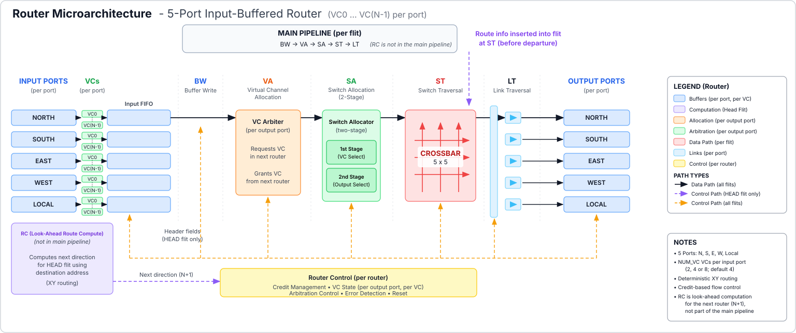

# Linnea NoC

Linnea is a parameterized **five-port, wormhole-switched Network-on-Chip** with
**deterministic XY routing**, **dynamic virtual-channel allocation**, and
**credit-based flow control**. Written in SystemVerilog for the Linnea multicore
processor, it provides reusable routers and a configurable two-dimensional mesh.
The implemented interface carries flits, VC IDs and credits. AXI4 network
interface integration is planned.

**[Architecture guide](docs/architecture.md) | [RTL modules](docs/rtl/) | [Build guide](docs/Makefile.md) | [Verification results](docs/dynamic_va_validation.md)**



## Getting started

Requires **Verilator**, **GNU Make**, and a **C++ toolchain**. Run from the
repository root. GTKWave is optional for viewing waveforms.

```bash
# Simulate a single router.
make TOP=router_top sim

# Simulate a 3x3 mesh.
make TOP=noc_mesh sim ROWS=3 COLS=3

# Select eight VCs and an eight-entry FIFO.
make TOP=router_top sim GFLAGS='-GNUM_VC=8 -GFIFO_DEPTH=8'

# Lint the router and run the complete regression.
make TOP=router_top lint
make regress
```

Simulation targets: `fifo`, `route_compute`, `noc_input_port`, `arbiter`,
`crossbar`, `noc_output_port`, `router_top`, `router_chain`, and `noc_mesh`.
Build products are in `obj_dir/`; waveforms are in `sim/`. For a FIFO waveform,
run `make TOP=fifo sim` then `make TOP=fifo wave`. `make clean` removes generated
outputs. See the **[build guide](docs/Makefile.md)** for further commands.

## What it supports

| Capability | Current implementation |
|---|---|
| Topology | Configurable `ROWS × COLS` mesh; each dimension is 1–8, default 2×2. |
| Router ports | Five: LOCAL, NORTH, EAST, WEST, SOUTH. LOCAL connects a tile’s source/sink; the others connect neighboring routers. |
| Routing | Deterministic XY: resolve the X coordinate first, then Y. Lookahead prepares the next router’s direction. |
| Packet switching | Wormhole switching with HEAD, BODY, TAIL and single-flit HEAD_TAIL packets. |
| Virtual channels | `NUM_VC=2`, `4` or `8` per input port; default 4. Each input VC has its own FIFO. |
| Traffic classes | The lower half of VCs is designated for requests and the upper half for responses. RTL preserves the class from the incoming VC sideband independently of header KIND. |
| VC allocation | Allocates a free downstream VC in the same class at each hop and reserves it until the packet's final flit traverses the switch. Each output VC considers eligible HEAD_TAIL requests before HEAD requests. |
| Switch allocation | Two round-robin stages: select one VC per input, then one input per output. Each physical link carries at most one flit per cycle. |
| Flow control | Per-output-VC credits prevent downstream FIFO overflow. Credits return when the receiver fetches a flit. |
| Buffering | Parameterized FIFO depth, registered FIFO output, empty-FIFO bypass and replacement fetch during a successful transfer. Default depth is 4. |
| Link interface | Flit data, valid, VC-ID sideband and a per-VC credit-return vector. |
| Flit width | Parameterized RTL with a 40-bit implemented header layout; the supplied benches validate 40-bit flits. |
| Reset | Shared clock with synchronous active-low reset. |

## Project status and roadmap

The router and mesh RTL implement the flit datapath and per-hop VC allocation.
The [2026-11-12 validation history](docs/dynamic_va_validation.md#historical-validation--2026-11-12)
records the initial dynamic allocator regression and strengthened chain reruns.

### Completed

- [x] Five-port router and parameterized XY mesh.
- [x] Per-input-VC FIFOs with registered output and empty-FIFO bypass.
- [x] Dynamic same-class VC allocation with packet-level reservation.
- [x] Two-stage round-robin switch allocation and per-VC credit accounting.
- [x] Lookahead routing and registered output links.
- [x] Assertions, self-checking benches and multi-hop remapping tests.
- [x] Module documentation and architecture diagrams.

### Remaining

- [ ] AXI4 network interface: packetization, depacketization and end-to-end integration tests.
- [ ] Additional protocol interfaces after AXI4 integration.
- [ ] Synthesis and area/resource measurements for the dynamic allocator.
- [ ] Static timing analysis, timing closure and FPGA implementation.
- [ ] Throughput, latency and contention measurements.
- [ ] Formal verification.

## Resume verification evidence — 2026-11-20

Source `328f41eab6347fb01466626cc87de96ac67bc2de`, clean working tree at
start. Verilator 5.020 (Debian 5.020-1).
[Environment](results/2026-11-20/environment.log) ·
[Exact commands, check counts and per-case evidence](docs/dynamic_va_validation.md#current-validation--2026-11-20)

| Executed command | Result |
|---|---|
| `make regress` | **45 passed, 0 failed** (exit 0). 37 assertion-enabled simulations and 8 strict RTL lint runs. [Log](results/2026-11-20/regression.log) |
| `bash tools/mutate_all.sh` and `bash tools/mutate_out.sh` | **8 of 8 detected** by functional checkers. All eight applied and ran, with zero survivors, skips or errors. [Core cases](results/2026-11-20/mutate_all.log) · [Output-port cases](results/2026-11-20/mutate_out.log) |
| `bash tools/assert_neg.sh` and isolated repaired rerun | Original definitions **6 fired, 1 stale skip**. Replacement suite **7 fired**, including the cross-class allocation assertion. Zero misses or errors in either completed suite. [Original](results/2026-11-20/assert_neg.log) · [Repaired](results/2026-11-20/assert_neg_repaired.log) |
| `make TOP=noc_mesh lint GFLAGS='-GROWS=8 -GCOLS=8 -GNUM_VC=8'` | **Passed** strict RTL lint and elaboration with assertions enabled. [Log](results/2026-11-20/mesh-8x8-lint.log) |
| `make TOP=noc_mesh OBJ_DIR=obj_8x8 sim ROWS=8 COLS=8 GFLAGS=-GNUM_VC=8` | Stopped the serial C++ build before link and simulation (exit 2). [Original attempt](results/2026-11-20/mesh-8x8-sim.log) |
| `make -C obj_8x8/v_noc_mesh -f Vtb_noc_mesh.mk -j6` | **Build passed.** Linked the same generated model in 498.02 s. [Build log](results/2026-11-20/mesh-8x8-build-resume.log) |
| `./obj_8x8/v_noc_mesh/run` | **Simulation passed** in 23.41 s with 106,916 checks, 8,064 packets and 30,240 flits scored. [Simulation log](results/2026-11-20/mesh-8x8-run.log) |

The fault suites used an isolated copy and a logging harness.

**Default bench checks.** FIFO 879, route compute 49,178, input port 171,
arbiter 103, crossbar 286, output port 139, router 104, strengthened
three-router chain 1,640, and 2×2 mesh 326.

**Functionally tested meshes.** Regression passed 2×2 at
`(NUM_VC, FIFO_DEPTH)` = (2,4), (4,4), (8,4), and (4,8). The additional
geometries at (4,4) were 1×2 (59 checks), 2×1 (59), 3×3 (1,933),
and 2×3 (805). The separate 8×8 run passed at (8,4). The sweeps vary VC
count and FIFO depth independently. The all-to-all bench requires two or
more tiles.

**Resume-safe claims.** Implemented a five-port wormhole XY router and mesh
with lookahead, per-hop same-class VC reservations and per-VC credits.
Passed the 45-run Verilator regression, demonstrated forced multi-hop
remapping in both traffic classes with four and eight VCs, and verified
64-router all-to-all traffic with eight VCs per port. Detected eight
injected RTL faults with functional checkers.

These results cover 40-bit flits and the listed workloads. Synthesis,
timing closure, formal proof, and FPGA implementation remain unverified.
AXI4 network interface integration is planned.

## Architecture and module documentation

**[Read the architecture guide](docs/architecture.md)** for the packet pipeline,
dynamic VC matching, traffic-class isolation, reservation lifetime, credit loops
and mesh wiring. Each module page includes its block diagram and interfaces.

| Module | Documentation |
|---|---|
| `router_top` | [Five-port router integration](docs/rtl/router_top.md) |
| `noc_mesh` | [Mesh topology and links](docs/rtl/noc_mesh.md) |
| `noc_input_port` | [Input buffering and packet state](docs/rtl/noc_input_port.md) |
| `arbiter` | [VC allocation, switch allocation and credits](docs/rtl/arbiter.md) |
| `crossbar` | [Switch datapath](docs/rtl/crossbar.md) |
| `noc_output_port` | [Header update and link registers](docs/rtl/noc_output_port.md) |
| `route_compute` | [XY routing and lookahead](docs/rtl/route_compute.md) |
| `fifo` | [Storage and empty-FIFO bypass](docs/rtl/fifo.md) |

## Source and documentation

| Location | Contents |
|---|---|
| [`rtl/`](rtl/) | Eight RTL modules. |
| [`tb/`](tb/) | Nine benches, shared flit helpers and the input-port mock arbiter. |
| [`docs/architecture.md`](docs/architecture.md) | System architecture and block responsibilities. |
| [`docs/rtl/`](docs/rtl/) | Per-module block diagrams, interfaces, state and behavior. |
| [`docs/tb/`](docs/tb/) | Testbench descriptions and coverage. |
| [`docs/images/`](docs/images/) | SVG diagrams; editable Graphviz sources are in `src/`. |
| [`tools/`](tools/) | Separate mutation and assertion-negative test scripts. |
| [`Makefile`](Makefile) | Simulation, lint, regression and waveform targets. |
| [`files.f`](files.f) | Language-server compilation list. |

## License

[MIT](LICENSE).

I write [blogs about this project](https://rohith-04.github.io/projects/noc/).
