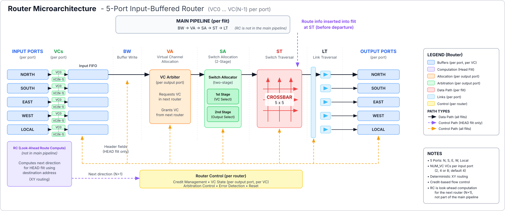

# Linnea NoC

Linnea is a parameterized **five-port, wormhole-switched Network-on-Chip** with
**deterministic XY routing**, **dynamic virtual-channel allocation**, and
**credit-based flow control**. Written in SystemVerilog for the Linnea multicore
processor, it provides reusable routers and a configurable two-dimensional mesh.
AXI4 is the planned network interface, with additional protocol interfaces to
follow. This checkout currently implements the flit-based router and mesh;
the AXI4 adapter is not yet included.

**[Architecture guide](docs/architecture.md) | [RTL modules](docs/rtl/) | [Build guide](docs/Makefile.md) | [Verification results](docs/dynamic_va_validation.md)**



## Getting started

Requires **Verilator**, **GNU Make**, and a **C++ toolchain**. Run from the
repository root. GTKWave is optional for viewing waveforms.

```bash
# Simulate a single router.
make TOP=router_top sim

# Simulate a 3x3 mesh.
make TOP=noc_mesh sim ROWS=3 COLS=3

# Select eight VCs and an eight-entry FIFO.
make TOP=router_top sim GFLAGS='-GNUM_VC=8 -GFIFO_DEPTH=8'

# Lint the router and run the complete regression.
make TOP=router_top lint
make regress
```

Simulation targets: `fifo`, `route_compute`, `noc_input_port`, `arbiter`,
`crossbar`, `noc_output_port`, `router_top`, `router_chain`, and `noc_mesh`.
Build products are in `obj_dir/`; waveforms are in `sim/`. For a FIFO waveform,
run `make TOP=fifo sim` then `make TOP=fifo wave`. `make clean` removes generated
outputs. See the **[build guide](docs/Makefile.md)** for further commands.

## What it supports

| Capability | Current implementation |
|---|---|
| Topology | Configurable `ROWS × COLS` mesh; each dimension is 1–8, default 2×2. |
| Router ports | Five: LOCAL, NORTH, EAST, WEST, SOUTH. LOCAL connects a tile’s source/sink; the others connect neighboring routers. |
| Routing | Deterministic XY: resolve the X coordinate first, then Y. Lookahead prepares the next router’s direction. |
| Packet switching | Wormhole switching with HEAD, BODY, TAIL and single-flit HEAD_TAIL packets. |
| Virtual channels | `NUM_VC=2`, `4` or `8` per input port; default 4. Each input VC has its own FIFO. |
| Traffic classes | Lower half of VCs carry requests; upper half carry responses. Class comes from the incoming VC sideband. |
| VC allocation | Dynamic allocation to any free downstream VC in the same class, independently at every hop. HEAD_TAIL has priority over HEAD. |
| Switch allocation | Two round-robin stages: select one VC per input, then one input per output. Each physical link carries at most one flit per cycle. |
| Flow control | Per-output-VC credits prevent downstream FIFO overflow. Credits return when the receiver fetches a flit. |
| Buffering | Parameterized FIFO depth, registered FIFO output, empty-FIFO bypass and replacement fetch during a successful transfer. Default depth is 4. |
| Link interface | Flit data, valid, VC-ID sideband and a per-VC credit-return vector. |
| Flit width | Parameterized RTL with a 40-bit implemented header layout; the supplied benches validate 40-bit flits. |
| Reset | Shared clock with synchronous active-low reset. |

## Project status and roadmap

**Current state: router and mesh RTL implemented and simulation-verified.**
The dynamic allocator passed the recorded 45-run regression, including nine
benches, eight lint targets, 24 parameter sweeps and four additional mesh
geometries. Final long-packet chain tests check remapping, credit returns and
flit ordering across multiple hops. See **[executed verification results](docs/dynamic_va_validation.md)**
for exact configurations, check counts and validation limits.

### Completed

- [x] Five-port router and parameterized XY mesh.
- [x] Per-input-VC FIFOs with registered output and empty-FIFO bypass.
- [x] Dynamic same-class VC allocation with packet-level reservation.
- [x] Two-stage round-robin switch allocation and per-VC credit accounting.
- [x] Lookahead routing and registered output links.
- [x] Assertions, self-checking benches and multi-hop remapping tests.
- [x] Module documentation and architecture diagrams.

### Remaining

- [ ] AXI4 network interface: packetization, depacketization and end-to-end integration tests.
- [ ] Additional protocol interfaces after AXI4 integration.
- [ ] Synthesis and area/resource measurements for the dynamic allocator.
- [ ] Static timing analysis, timing closure and FPGA implementation.
- [ ] Throughput, latency and contention measurements.
- [ ] Formal verification and reruns of the separate mutation/assertion-negative suites for the updated allocator.

The current verification uses 40-bit flits, VC counts 2/4/8 and selected FIFO
depths 4/8. It does not establish synthesis or timing closure. LOCAL-to-LOCAL
loopback is outside the routing table; the mesh bench requires at least two tiles.

## Architecture and module documentation

**[Read the architecture guide](docs/architecture.md)** for the packet pipeline,
dynamic VC matching, traffic-class isolation, reservation lifetime, credit loops
and mesh wiring. Each module page includes its block diagram and interfaces.

| Module | Documentation |
|---|---|
| `router_top` | [Five-port router integration](docs/rtl/router_top.md) |
| `noc_mesh` | [Mesh topology and links](docs/rtl/noc_mesh.md) |
| `noc_input_port` | [Input buffering and packet state](docs/rtl/noc_input_port.md) |
| `arbiter` | [VC allocation, switch allocation and credits](docs/rtl/arbiter.md) |
| `crossbar` | [Switch datapath](docs/rtl/crossbar.md) |
| `noc_output_port` | [Header update and link registers](docs/rtl/noc_output_port.md) |
| `route_compute` | [XY routing and lookahead](docs/rtl/route_compute.md) |
| `fifo` | [Storage and empty-FIFO bypass](docs/rtl/fifo.md) |

## Source and documentation

| Location | Contents |
|---|---|
| [`rtl/`](rtl/) | Eight RTL modules. |
| [`tb/`](tb/) | Nine benches, shared flit helpers and the input-port mock arbiter. |
| [`docs/architecture.md`](docs/architecture.md) | System architecture and block responsibilities. |
| [`docs/rtl/`](docs/rtl/) | Per-module block diagrams, interfaces, state and behavior. |
| [`docs/tb/`](docs/tb/) | Testbench descriptions and coverage. |
| [`docs/images/`](docs/images/) | SVG diagrams; editable Graphviz sources are in `src/`. |
| [`tools/`](tools/) | Separate mutation and assertion-negative test scripts. |
| [`Makefile`](Makefile) | Simulation, lint, regression and waveform targets. |
| [`files.f`](files.f) | Language-server compilation list. |

## License

[MIT](LICENSE).

I write [blogs about this project](https://rohith-04.github.io/projects/noc/).
