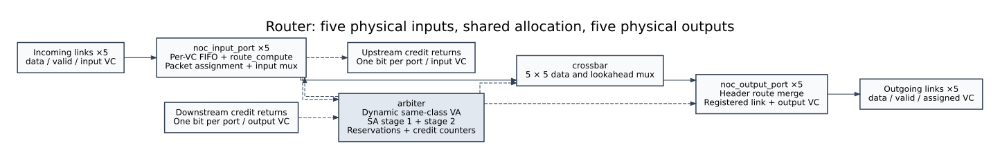
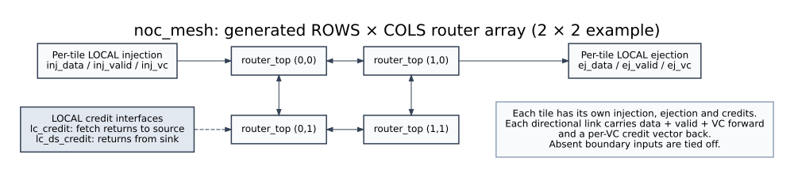

# Linnea NoC architecture

Linnea connects tiles through a credit-based, wormhole-switched mesh. A tile
injects a packet through its router’s LOCAL input. The routers forward its
flits along a deterministic XY path, then eject them through the destination’s
LOCAL output. Virtual channels (VCs) provide separate FIFO and packet state on
a shared physical input link.

## Router organization

| Block | Responsibility | Detailed diagram and interface |
|---|---|---|
| `fifo` | Store flits; provide a registered read output and empty-FIFO bypass. | [FIFO](rtl/fifo.md) |
| `route_compute` | Select this router’s output and compute the next router’s direction. | [Lookahead routing](rtl/route_compute.md) |
| `noc_input_port` | Demultiplex incoming VC IDs, manage per-VC FIFOs and packet assignments, and select the SA-picked flit. | [Input port](rtl/noc_input_port.md) |
| `arbiter` | Match packets to free same-class output VCs, perform both SA stages, track reservations and downstream credits. | [Allocator](rtl/arbiter.md) |
| `crossbar` | Select one physical input’s flit and lookahead for each granted physical output. | [Crossbar](rtl/crossbar.md) |
| `noc_output_port` | Rewrite only a header’s route field and register data, valid and the assigned downstream VC. | [Output port](rtl/noc_output_port.md) |
| `router_top` | Instantiate five input ports, the shared allocator/crossbar, and five output ports; apply port-presence settings. | [Router integration](rtl/router_top.md) |
| `noc_mesh` | Generate a rectangular router array and connect neighboring links and credit returns. | [Mesh](rtl/noc_mesh.md) |

## Packet flow

The functional stages are buffer write, virtual-channel allocation (VA), switch
allocation (SA), switch traversal, and registered link transmission. These names
describe responsibilities, not five independent pipeline registers. Both SA
stages operate combinationally in the same cycle.

1. The incoming `vc_id` chooses the input FIFO. An empty FIFO can bypass its
   storage into the registered FIFO output when writing and fetching together.
2. A HEAD or HEAD_TAIL determines its current output. LOCAL injection computes
   XY routing from the destination; a directional input consumes the lookahead
   route supplied by the previous router. Route computation also prepares the
   next router’s direction.
3. A head without an assignment requests VA. Its successful grant captures the
   downstream VC in `out_vc`; the current output is retained in `out_port` and
   `assignment_valid` records ownership.
4. SA stage 1 chooses one eligible VC per physical input. Eligibility uses the
   assigned output port and output VC’s credits. Stage 2 chooses one physical
   input per output, so each input and output carries at most one flit that cycle.
5. The crossbar selects the winning flit and lookahead. The output port rewrites
   ROUTE only for HEAD/HEAD_TAIL, then registers the flit and assigned VC-ID.
   BODY/TAIL payloads pass through unchanged.

## Dynamic VC allocation and classes

For `NUM_VC=2`, `4` or `8`, the lower half of VC indices are requests and the
upper half are responses. The link’s incoming VC sideband is authoritative;
routers do not derive class from header KIND or other payload bits.

Each physical output scans its free downstream VC rows in increasing index
order. A row scans flattened `(input port, input VC)` requesters round-robin,
first considering HEAD_TAIL and then HEAD. It accepts only the same traffic
class and excludes requesters already selected by an earlier row. This can
grant several distinct output VCs in one cycle without assigning a requester
twice. Each granted row advances its round-robin pointer past its winner.

The old VC-matched rule, `output_vc = input_vc`, is superseded. With four VCs,
two packets entering on VC0 at different inputs can acquire output VC0 and VC1
on the same output port. SA still serializes their use of the physical link.

The output VC becomes the downstream router’s input FIFO index. That router
can remap it again, within the same class. BODY and TAIL use the assignment
stored for their packet at that hop. With two VCs there is only one VC per
class, so class-preserving allocation necessarily retains the index.

## Ownership and credits

An output `(port, VC)` is reserved from the VA-grant edge until its packet’s
TAIL or HEAD_TAIL wins final SA and actually traverses the switch. A BODY, a
stalled TAIL, or a TAIL denied at SA stage 2 does not release it. A released
VC becomes available to VA in the following cycle.

Ownership and FIFO space are independent. VA does not inspect credits. SA
checks `credit_count[assigned_output_port][assigned_output_vc]`; transmission
consumes one credit from that exact resource. A downstream FIFO returns a
credit when it fetches a flit, indexed by its own input VC. The return travels
back along the link that fed that FIFO. Simultaneous increment and decrement
hold the counter unchanged.

The FIFO head register, replacement fetch on successful SA, and empty-FIFO
bypass retain their existing behavior. A VC assignment persists through
backpressure and through gaps between a packet’s flits.

## Mesh connections and boundaries

Every tile has its own LOCAL source/sink interfaces. An EAST output feeds the
neighbor’s WEST input, and its credits come back from that WEST input. NORTH
pairs with SOUTH in the same way. Forward links carry data, valid and VC-ID;
reverse credit links carry one bit per VC.

Coordinates are three bits, supporting mesh dimensions 1–8 each. XY resolves X
before Y, with SOUTH increasing Y. Boundary input links are tied off through
port-presence settings. Outward outputs remain observable so assertions can
catch an illegal route. LOCAL-to-LOCAL loopback is not a legal router turn;
the supplied mesh bench therefore requires at least two tiles.

## Scope and trade-offs

The current verification uses 40-bit flits, selected VC counts 2/4/8 and FIFO
depths 4/8. Wider flit parameters do not define a new packet layout automatically.
The current allocator has simulation/lint evidence; synthesis, area and timing
closure remain unverified. See [executed results](dynamic_va_validation.md).

Ordered matching introduces a dependency between output-VC rows. Additional
assignment registers and variable SA credit lookup also need synthesis/STA
assessment. No additional pipeline stage was introduced. Physical output
bandwidth remains one flit per cycle. Strict HEAD_TAIL priority can starve HEAD
traffic under a continuous supply of singles. Lower-index free VCs are
preferred, including a free zero-credit VC before a higher-index credited VC.
