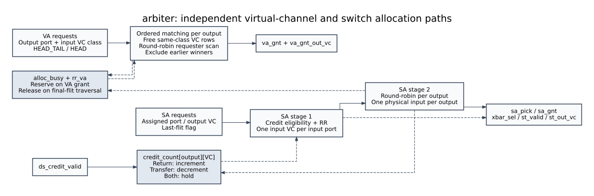

# `arbiter` - `rtl/arbiter.sv`

Dynamic class-constrained virtual-channel allocation (VA), two-stage switch
allocation (SA), and downstream credit bookkeeping for one five-port router.
The former VC-matched rule (`output_vc = input_vc`, v2 §4.4–4.5) is superseded.
The architecture description below follows the current RTL.

## 1. Ports and state

`NUM_PORTS` is five: LOCAL=0, NORTH=1, EAST=2, WEST=3, SOUTH=4.
`NUM_VC` supports 2, 4, and 8; `VC_W = $clog2(NUM_VC)`.
`DIR_CREDITS` and `LOCAL_CREDITS` initialize and bound the corresponding
per-output-VC counters. `CRED_W` holds the larger depth, inclusive.
`REQ_W = $clog2(NUM_PORTS * NUM_VC)` holds a flattened input requester.
Direction fields encode LOCAL=0, NORTH=1, EAST=2, WEST=4, SOUTH=8.

| Signal | Width | Direction | Source → Destination | Working / description |
|---|---|---|---|---|
| `clk`, `rst_n` | 1 each | input | router → sequential state | Rising edge; synchronous active-low reset. |
| `va_req` | ports × VCs | input | input ports → VA | HEAD/HEAD_TAIL without an allocation. |
| `va_req_out_port` | ports × VCs × 4 | input | input ports → VA | Required physical output, direction encoded. |
| `va_req_single` | ports × VCs | input | input ports → VA | HEAD_TAIL priority tier. |
| `va_gnt` | ports × VCs | output | VA → input ports | Combinational grant to an input `(port, VC)`. |
| `va_gnt_out_vc` | ports × VCs × VC_W | output | VA → input-port `out_vc` | Actual allocated downstream VC, meaningful on grant. |
| `sa_req` | ports × VCs | input | input ports → SA | Active flit with a valid allocation. |
| `sa_req_out_port` | ports × VCs × 4 | input | latched input-port route → SA | Packet's assigned output port. |
| `sa_req_out_vc` | ports × VCs × VC_W | input | input-port `out_vc` → SA | Packet's assigned downstream VC; independent of input FIFO index. |
| `sa_req_last` | ports × VCs | input | input ports → release logic | TAIL or HEAD_TAIL; release requires final SA grant. |
| `sa_pick` | ports × VCs | output | SA stage 1 → input mux | At most one VC per physical input. |
| `sa_gnt` | ports × VCs | output | SA stage 2 → input ports | Actual switch traversal, at most one per input and output. |
| `xbar_sel` | ports × 3 | output | SA → crossbar | Winning physical input index per output. |
| `st_valid` | ports | output | SA → crossbar/output ports | Physical output transfer this cycle. |
| `st_out_vc` | ports × VC_W | output | SA → link register | Allocated downstream VC of transmitted flit; zero when idle. |
| `ds_credit_valid` | ports × VCs | input | downstream FIFO/NI → counters | Returned credits, indexed by downstream physical port and VC. |

| Name | Width | Kind | Reset | Working / description |
|---|---|---|---|---|
| `alloc_busy[o][k]` | ports × VCs | register | 0 | Reservation of output port `o`, downstream VC `k`. |
| `credit_count[o][k]` | ports × VCs × CRED_W | register | downstream depth | Free downstream FIFO slots. Independent of ownership. |
| `rr_va[o][k]` | REQ_W per row | register | 0 | First flattened input requester considered by row `(o,k)`. |
| `rr1[p]` | VC_W per input | register | 0 | SA stage-1 input-VC pointer. |
| `rr2[o]` | 3 per output | register | 0 | SA stage-2 physical-input pointer. |
| `row_ridx`, `row_val` | REQ_W / 1 per row | combinational | n/a | Winning flattened requester and row-grant validity. |
| `va_kept`, `va_row_count` | integer per requester / row | assertion view | n/a | Independent checks on input and output grant uniqueness. |
| `s1_idx`, `s1_vc`, `s1_oport`, `s1_last`, `s1_valid` | per input | combinational | n/a | Input FIFO index and allocated output resource remain distinct. |
| `cr_dec`, `cr_inc`, `cr_release` | ports × VCs each | combinational | n/a | Transfer, return, and successful final-flit transfer by resource. |

## 2. RTL explanation

### Dynamic matching and traffic classes

Input VC indices `[0, NUM_VC/2-1]` are requests; the upper half are responses.
The incoming link's `vc_id` selects the local FIFO and therefore determines
class. Header KIND and opaque payload bits do not determine allocation.
A row can select input VC `v` only when `v/(NUM_VC/2) == k/(NUM_VC/2)`.

Each output independently processes its downstream VC rows in increasing
index order. For each free row:

1. Scan flattened input requesters `r = p*NUM_VC + v` from `rr_va[o][k]`,
   wrapping around all `NUM_PORTS*NUM_VC` requesters.
2. Consider only requests for output `o`, in the row's class, not selected
   by an earlier row. First scan HEAD_TAIL requests; if none exists, scan
   all HEAD requests in the same round-robin order.
3. Grant the first eligible requester, return row index `k` on
   `va_gnt_out_vc[p][v]`, and exclude that requester from later rows.
4. At the clock edge, set `alloc_busy[o][k]`; advance this row's pointer to
   `(r+1) % (NUM_PORTS*NUM_VC)`. Rows without grants retain their pointers.

This is ordered greedy matching with explicit input conflict resolution.
A requester cannot win twice, and each row has only one winner. Since a
request has one output and can use every free VC in its class, the scan
allocates `min(requesters, free rows)` per output and class. Multiple VCs of
one physical input can win VA together; only SA constrains the input datapath
to one flit per cycle. No grant feeds backward into an earlier row.

VA is credit-independent. The input port captures `out_vc` on the grant and
retains `out_port`, `out_vc`, and `assignment_valid` throughout the packet.
At every next router the previous output VC becomes the new input FIFO
index, and that router allocates its own output VC within the same class.
For four VCs, an incoming request VC0 can therefore become VC1 at a congested
hop and VC0 again at a later free hop.

### Reservation lifetime and SA

A reservation starts at the VA-grant edge. HEAD/BODY transmissions, missing
credits, a waiting TAIL, and a TAIL losing SA stage 2 all retain ownership.
Only a TAIL/HEAD_TAIL that wins final SA releases its assigned `(o,k)`.
VA tests registered `alloc_busy`, so a releasing row cannot be allocated
until the following cycle. There is no same-cycle release bypass.

SA remains two combinational stages in one cycle:

- Stage 1 masks `sa_req[p][v]` with
  `credit_count[dir_to_idx(sa_req_out_port[p][v])][sa_req_out_vc[p][v]] > 0`,
  then selects one input VC round-robin. `rr1[p]` advances past that input
  VC only after a stage-2 grant.
- Stage 2 picks one of those physical inputs per output, round-robin;
  `rr2[o]` advances past the actual winner. `st_out_vc` carries its allocated
  downstream VC, while `sa_gnt` still addresses its original local FIFO.

Credit decrement and reservation release use `st_out_vc`. Credit increments
use the returned VC vector. Simultaneous increment/decrement holds the
counter; neither event also holds it. FIFO fetch-based credit return,
registered FIFO output, bypass, and replacement-fetch behavior are unchanged.

### Fairness and implementation trade-offs

Round-robin fairness applies within a priority tier when resources become
available. Strict HEAD_TAIL priority can starve HEAD traffic under an
unbounded supply of single-flit packets, as with the previous priority policy.
Lower-index free output VCs are preferred; output-VC utilization is not
rotated. A free zero-credit row can be selected even when another free row
has credits, because VA deliberately does not inspect credits. Requester
fairness is handled by each row's pointer.

Matching creates a combinational dependency between rows of the same output.
The flattened scans and exclusion mask cost more logic than VC matching;
VA pointers also widen, and each input VC adds an output-VC register. Physical
output bandwidth remains one flit per cycle, and no pipeline stage is added.
The variable output-VC index also makes the SA credit lookup a dynamic mux,
where VC matching previously allowed constant-index optimization. Area and
timing require synthesis/STA; simulation and lint do not establish
timing closure. Synthesis tools may optimize the constant divisions/modulos,
but no area or critical-path measurement is claimed.

## 3. Testing explanation

Run `make TOP=arbiter sim`, and repeat with `GFLAGS='-GNUM_VC=2'` and `8`.
The updated bench retains the original reset, two-stage SA, fairness, credit
exhaustion/recovery, and simultaneous-return checks. Dynamic tests add:

- Same incoming VC on two ports, separate output VCs when class capacity permits.
- Concurrent classes, more requesters than rows, and multiple VCs per input.
- One remaining row, HEAD_TAIL priority, and equal-tier round-robin rotation.
- Nonfinal transfers retaining ownership; a stage-1-selected TAIL denied stage 2.
- Registered release/reallocation, zero-credit VA and SA stalls, and HEAD_TAIL release.
- Allocated-VC sideband and simultaneous credit return/transmission.

RTL assertions check class isolation, grant/request consistency, at most one
row per requester, at most one grant per row, no busy-row allocation,
reservation persistence, release legality, SA uniqueness, XY legality, credit
bounds, and exact increment/decrement/hold transitions. `router_top` checks
live ownership and assignment sidebands independently across module seams.
`tb_router_chain` forces a second-hop VC change in both classes, checks every
flit's VC/order/distinct payload through a packet longer than the credit pools, and monitors packet serialization on every link VC.
The mesh scoreboard also checks end-to-end traffic class.

Executed results for this change are recorded in [the validation record](../dynamic_va_validation.md).
