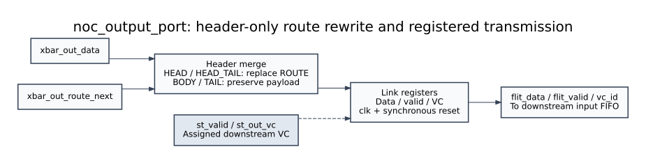

# `noc_output_port` - `rtl/noc_output_port.sv`



One per output port. Two jobs, in order: **splice this router's lookahead
route into the header**, then **register the flit onto the link**.

That register is the LT (link transmit) boundary of the router. Everything
before it is inside the router's timing; everything after it is the physical
link, and it is one full cycle of the credit loop (spec §3, §6).

---

## 1. Ports and state

### 1.1 Parameters

| Name | Type | Default | Constraint | Meaning |
|---|---|---|---|---|
| `FLIT_W` | `int` | 40 | `-` | Flit width. The merge writes only `[13:10]`, so the width sizes the payload path; the "nothing outside `[13:10]` moved" assertion is expressed in terms of it, because a 32-bit mask would stop covering the upper bits once the word grows past 32. |
| `NUM_VC` | `int` | 4 | 2, 4 or 8 | Only used to size the `VC_W` sideband (`st_out_vc` / `vc_id`): `VC_W = (NUM_VC > 1) ? $clog2(NUM_VC) : 1`. `router_top` must pass the same `NUM_VC` it passes to the rest of the router, or the sideband would be narrower than the index it carries. |

The module is instantiated once per output port.

### 1.2 Port declaration

Direction is from the DUT's point of view: `input` = driven by `crossbar`
or `arbiter`, `output` = driven onto the link towards the downstream router's
`noc_input_port` (or the network interface).

| Signal | Width | Direction | Source → Destination | Working / description |
|---|---|---|---|---|
| `clk` | 1 | input | clock generator → `link_reg`, and → every `assert property` | Rising edge loads the link register; also the sampling event for the assertions. |
| `rst_n` | 1 | input | reset generator → `always_ff` and `disable iff` | Synchronous, active low, matching `fifo.sv`. Clears `flit_valid` and, for waveform determinism, `flit_data` and `vc_id` too - an unreset link register would hold its previous value across a reset and look like a flit being held forever. |
| `xbar_out_data` | `FLIT_W` (40) | input | `crossbar` → header merge → `link_reg` | Payload for this output. Valid only when `st_valid` is high (the crossbar forces zero otherwise), but the merge is applied unconditionally and the register gates it, so the two cases cannot differ. |
| `xbar_out_route_next` | 4 | input | `crossbar` → header merge → bits `[13:10]` of `merged` | **This** router's lookahead for the *next* router. One-hot `DIR_*` (see `docs/rtl/route_compute.md` §1.2). It replaces the stale route field the payload carried in from the previous hop. |
| `st_valid` | 1 | input | `arbiter` (SA stage 2) → `link_reg` enable and every assertion's antecedent | "This output carries a flit this cycle." Registered into `flit_valid`, so a grant in cycle *g* puts the flit on the wire in *g+1*. |
| `st_out_vc` | `VC_W` (2 at `NUM_VC = 4`) | input | `arbiter` → `link_reg` → `vc_id` | The `vc_id` sideband: which downstream VC the flit belongs to. The next router's input port demuxes its per-VC FIFOs with it. |
| `flit_data` | `FLIT_W` (40) | output | `noc_output_port` → downstream `noc_input_port` (or the NI) | Registered payload, already merged. |
| `flit_valid` | 1 | output | `noc_output_port` → downstream input port's write enable | Registered `st_valid`. |
| `vc_id` | `VC_W` (2 at `NUM_VC = 4`) | output | `noc_output_port` → downstream input port's VC select | Registered `st_out_vc`, gated to `'0` when idle. |

### 1.3 Registers and state

| Name | Width | Kind | Reset | Working / description |
|---|---|---|---|---|
| `merged` | `FLIT_W` (40) | `logic` (combinational) | n/a | Output of the header merge. Feeds *only* the link register - nothing else in the design reads it (the bench does, hierarchically - §3.2), which is why the merge properties are checked here and not at the register. |
| `flit_data` | `FLIT_W` (40) | register | `'0` | Registered payload: `st_valid ? merged : '0`. |
| `flit_valid` | 1 | register | `1'b0` | Registered `st_valid`. |
| `vc_id` | `VC_W` | register | `'0` | Registered `st_out_vc`, gated to zero when idle. |

There is no FIFO, no counter, and no credit state in this module. The credit
loop runs *through* it - the register is one cycle of it - but the counting
lives in `rtl/arbiter.md`.

---

## 2. RTL explanation

### 2.1 The header merge

```systemverilog
merged = xbar_out_data;              // default: payload exactly as it arrived
if (xbar_out_data[0])                // is_head == type[0]
  merged[13:10] = xbar_out_route_next;
```

The crossbar carries the payload as it sat in the sender's FIFO, with a
**stale** route field: that field was written by the *previous* hop's route
compute and describes where to go from there, not from here. The lookahead
computed by this router arrives as a separate 4-bit signal and is spliced in
as the flit crosses.

Three deliberate choices:

- **Default-then-overlay, not a `case`.** Untouched bits are payload bits by
  construction, so BODY and TAIL payloads cannot be corrupted by an edit that
  forgets a branch - and a flit type added later is safe automatically
  rather than silently falling through a `case`.
- **`xbar_out_data[0]`, not `type == HEAD || type == HEAD_TAIL`.** The
  encoding is `00 BODY / 01 HEAD / 10 TAIL / 11 HEAD_TAIL`, so `type[0]` is
  exactly `is_head`, which is the single spelling the rest of the design
  uses. One spelling here means an encoding change has exactly one place to
  break and one assertion to trip. This is the most encoding-coupled line in
  the whole router.
- **Only `[13:10]` is written.** `[3:2]` is the KIND field (it was `VC_ID`
  when D3 was written) and is deliberately left alone: the sideband `vc_id`
  is the authoritative VC, KIND is set once by the source NI and has nothing
  to do with the hop being taken, and rewriting it here would look correct in
  a single-router test and corrupt every packet in a chain.

Why the merge lives here and not in the crossbar: the crossbar is stateless
and knows nothing about flit formats. Putting a format-dependent splice in it
would force every crossbar port to carry `route_next` for a path only HEAD
flits use, and the merge has to complete before the link register loads -
which is exactly where this module puts it.

### 2.2 The link register

```systemverilog
flit_data  <= st_valid ? merged : '0;
flit_valid <= st_valid;
vc_id      <= st_valid ? st_out_vc : '0;
```

`flit_valid` is registered from `st_valid`, so a grant in cycle *g* puts the
flit on the wire in *g+1* - spec §3's timeline (grant in c2, header on the
output link in c3). Gating the payload with `st_valid` costs nothing (the
crossbar already drives zero when idle) and makes it structurally impossible
for `flit_data` and `flit_valid` to disagree about whether a flit was
present.

**Credit-loop consequence (spec §6):** this register is one cycle of the
credit loop. If the physical link needs more pipelining, it is added *after*
this point and the loop grows by that many cycles; nothing inside the router
changes. `tb_router_chain`'s section-6 test measures that loop end to end.

### 2.3 Assertions

The merge is pure combinational logic on a format field, so it is checked as
a combinational property - checking it a cycle later, at the register, would
confirm the register and not the splice.

| # | Property | What it protects |
|---|---|---|
| 1 | `(st_valid && is_head) \|-> route_next` is one of the five `DIR_*` codes | The lookahead itself. A 2-bit type field has no illegal values, so "the encoding is valid" would assert nothing; `route_next` is the field that can be corrupted *and still reach the next router*. Gated on `st_valid` because an idle port's `route_next` is a don't-care by spec definition. |
| 2 | `(st_valid && is_head) \|-> merged[13:10] == route_next` | The splice actually happened. |
| 3 | `(st_valid && !is_head) \|-> merged[13:10] == data[13:10]` | The mirror image. Without it, a merge condition that became "always" would still pass #2 while quietly corrupting every BODY and TAIL payload. |
| 4 | `merged[3:2] == data[3:2]` (ungated by `st_valid`) | Assumption D3 - the KIND field (formerly `VC_ID`) is never touched. Ungated because the splice must not depend on whether a flit is present, and this is the cheapest way to say so. |
| 5 | `(merged & ~ROUTE_BITS) == (data & ~ROUTE_BITS)` | Everything outside `[13:10]` survives, stated once for the whole word so a future edit to some *other* field is caught too. `ROUTE_BITS` is the mask for bits 13:10, declared `FLIT_W`-wide precisely so a 32-bit literal cannot be zero-extended into a 40-bit compare and quietly stop checking the upper eight bits. |
| 6 | `st_valid \|=> flit_valid` | The register is exactly one cycle behind the grant (§2.2). |
| 7 | `!st_valid \|=> !flit_valid` | And does not assert without one. |
| 8 | `st_valid \|=> flit_valid && vc_id == $past(st_out_vc)` | The sideband travels with its flit. A `vc_id` disagreeing with the flit beside it would make the next router buffer into the wrong FIFO while the credit is decremented in the right one - an error that only surfaces much later as a mis-sequenced packet. |

Properties 6–8 are written `|=>` rather than the equivalent `|-> ##1`: this
toolchain does not accept the latter, and `|=>` is the more direct statement
of "in the cycle after" anyway. `disable iff (!rst_n)` matters on all three -
without it the first sample after reset release would compare against an
undefined previous cycle and fail spuriously. See the language-limit table in
`README.md`.

---

## 3. Testing explanation

**Bench:** `tb/tb_noc_output_port.sv`, top module `tb_noc_output_port`
(**139** checks).
**Run:** `make TOP=noc_output_port sim` → `ALL 139 CHECKS PASSED`.

### 3.1 What the bench drives

The module is small enough to test by enumeration of the interesting input
classes rather than randomly:

- **Every flit type across the merge** - HEAD, BODY, TAIL, HEAD_TAIL, each
  with a non-zero payload and a legal `route_next` deliberately different
  from the stale route field the flit carries in. The check is that
  `[13:10]` changed for HEAD/HEAD_TAIL and that **every other bit**,
  including `[3:2]` and `[1:0]`, is bit-identical to the input.
- **Payload preservation** - BODY and TAIL are checked with payload patterns
  whose `[13:10]` bits are deliberately non-zero, so a merge that fires on
  the wrong type produces a visible difference rather than a coincidental
  match. This is the mutation the suite uses: *route merge applied to every
  flit*.
- **KIND vs the sideband (D3, in isolation)** - a HEAD whose header KIND is
  not the value the `vc_id` sideband carries: the in-flit KIND is left alone,
  the sideband carries its own value, and neither is confused for the other;
  plus a TAIL whose payload sits in the same slot.
- **Idle cycles** - `st_valid = 0` must give `flit_valid = 0` with zeroed
  data and sideband even with a non-zero payload parked on the crossbar.
  `merged` is checked against the reference in idle cycles too: the merge
  runs unconditionally, only the register is gated (§2.1).
- **Back-to-back beats** - eight consecutive cycles with a different payload
  every time, so a register that only updated on an *edge* of `st_valid` and
  held its word is caught directly rather than inferred.
- **Pipeline timing** - grant in cycle *g* requires `flit_valid` in *g+1*
  and no `flit_valid` in *g*, and requires `vc_id` to equal the `st_out_vc`
  that was present in *g* - including on idle beats, so a sideband that only
  updated while `st_valid` was high cannot leak into one.
- **Reset** - all three outputs cleared, and `flit_valid` staying low until
  the first grant after release.

### 3.2 Bench mechanics

Stimulus is applied just after a negedge, the combinational half is checked
before the posedge, and the registered half one cycle later. The bench's one
hierarchical reference is the DUT's combinational `merged` net, which it
compares against `ref_merge` from `tb/noc_tb_pkg.sv` - the package's
reference model of the merge, so a bug in the DUT's condition cannot be
mirrored by an identical bug in the checker. The same `cycle` task then
checks `flit_data` / `flit_valid` / `vc_id` after the edge, because the
merge and the register have to agree: a bench that checked only one of them
would pass happily on a DUT where the register captured a different word
than the one the merge produced.

### 3.3 Assertion coverage

All eight properties in §2.3 are live during the run. One of them is proven
to fire by `tools/assert_neg.sh`, which builds with `--assert` **on**:

| Case | Mutation | Result |
|---|---|---|
| `noc_output_port: header merge never happens` | `if (xbar_out_data[0])` → `if (1'b0)` | `%Error: noc_output_port.sv:202: Assertion failed ... HEAD route not updated (have 8, want 2)` |

Without `--assert` the two merge mutations are caught by the bench instead
(`tools/mutate_out.sh`) - see §3.4.

### 3.4 Mutation sanity

Both mutations in `tools/mutate_out.sh` target the merge condition, and a
third lives in `tools/mutate_all.sh`. All three are killed by `tb_router_top`,
which both scripts build **without** `--assert`, so it is the bench rather
than the SVA that catches them:

| Mutation | Script | Result |
|---|---|---|
| `if (xbar_out_data[0]) begin` → `if (1'b0)` - route merge never happens | `mutate_out.sh` | **killed - 3/104** |
| `if (xbar_out_data[0]) begin` → `if (1'b1)` - route merge applied to every flit | `mutate_out.sh` | **killed - 2/104** |
| `merged[13:10] = xbar_out_route_next` → `= 4'b0100` - wrong direction merged | `mutate_all.sh` | **killed - 3/104** |

The scripts print a lowercase `killed` beside `tb_router_top`'s
`CHECKS FAILED` line. All three mutants still let every packet arrive, so
all 104 of that bench's checks are evaluated in each case (the clean run is
`ALL 104 CHECKS PASSED`) - the failures are about *where* a packet went,
not *whether* it arrived. See `tb_router_top.md` §3.4 for why that
denominator moves under other mutants.

The third is the one that proves the
*value* is right, not just that the splice fired: a merge that writes a
constant direction still satisfies "the condition was true", so only
comparing the result against `route_next` catches it.

### 3.5 What the single-router bench cannot show

`tb_noc_output_port` and `tb_router_top` can prove the merge happens and
that the value is right - they cannot prove the *next router reads it*,
because there is no next router. That is what `tb_router_chain` is for: it is
the only bench where the merged field crosses a real link and is consumed as
`route_in` by the downstream `route_compute`, and it checks the field again
at final ejection (`docs/tb/tb_router_chain.md`).
