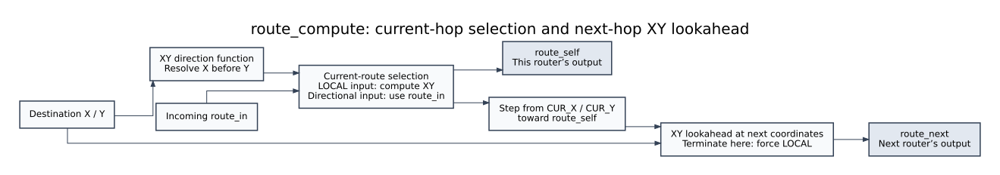

# `route_compute` - `rtl/route_compute.sv`



Purely combinational dimension-order (XY) lookahead routing. It takes a
packet's destination and this router's coordinates and answers two questions
in the same cycle: *which port does this router use?* (`route_self`) and
*what will the next router decide?* (`route_next`). The second answer is the
lookahead that gets merged into the header on the way out, which is what
removes route computation from the critical path of every hop after the
first.

There is no `clk` and no `rst_n`. The module never latches anything;
`noc_input_port` samples `route_self` into its per-VC control register when a
head flit arrives, and `noc_output_port` samples `route_next` at
transmit time.

---

## 1. Ports and state

### 1.1 Parameters

| Name | Type | Default | Meaning |
|---|---|---|---|
| `CUR_X` | `logic [2:0]` | `'0` | This router's X coordinate. Compile-time, per instance - one value per router, baked into all five of its `route_compute` instances. |
| `CUR_Y` | `logic [2:0]` | `'0` | This router's Y coordinate. Y **increases downward** (see §2.2). |
| `IS_LOCAL_PORT` | `bit` | 0 | `1` for the LOCAL instance (a freshly injected packet has no incoming header, so `route_self` must be computed), `0` for the four cardinal instances (the previous router already computed it; `route_self` is a field read). This one parameter is the *only* difference between the two port types - everything downstream of step 1 is identical hardware, which is why there are not two modules. |

### 1.2 Port declaration

Direction is from the DUT's point of view: `input` = driven by
`noc_input_port`, `output` = consumed by `noc_input_port` /
`noc_output_port`.

| Signal | Width | Direction | Source → Destination | Working / description |
|---|---|---|---|---|
| `dest_x` | 3 | input | HEAD flit bits `[6:4]`, sliced by `noc_input_port` → X comparator in `compute_dir` | Packet destination X. Carried unchanged through the whole route; never modified by any hop. |
| `dest_y` | 3 | input | HEAD flit bits `[9:7]`, sliced by `noc_input_port` → Y comparator in `compute_dir` | Packet destination Y. Also carried untouched end to end - the chain bench's scoreboard checks both fields byte-for-byte at ejection. |
| `route_in` | 4 | input | Incoming HEAD's ROUTE field `[13:10]`, as written by the *sender's* `route_next` → step 1 field read | This router's exit direction, already computed for it on the previous hop. **Unused when `IS_LOCAL_PORT = 1`** - there is no incoming header yet. This is the lookahead being *consumed*. |
| `route_self` | 4 | output | `route_compute` → `noc_input_port` (sampled into the per-VC control register at head arrival; gates VA) | `own_route`: this router's exit port for this packet, one-hot (`DIR_*`). On a LOCAL port it is computed fresh; on a cardinal port it is `route_in` passed through. |
| `route_next` | 4 | output | `route_compute` → `noc_output_port` (captured at SA-win / transmit time, merged into header bits `[13:10]`) | Lookahead for the **next** router: what *it* will decide, computed here so it does not have to be recomputed there. Has pipeline slack - it is only needed at stage 3, not on VA's critical path, so where its register lives is `noc_output_port`'s business. |

The direction encoding used on all four `4`-bit route signals:

| Value | Name | Meaning |
|---|---|---|
| `4'b0000` | `DIR_LOCAL` | terminate here, hand to the network interface |
| `4'b0001` | `DIR_NORTH` | decrease Y |
| `4'b0010` | `DIR_EAST` | increase X |
| `4'b0100` | `DIR_WEST` | decrease X |
| `4'b1000` | `DIR_SOUTH` | increase Y |

This is one-hot, which is what makes `$countones(...) <= 1` and the
`route_next` legality assertions in `noc_output_port` meaningful.

### 1.3 Registers and state

There are none. Every signal below is combinational:

| Name | Width | Kind | Reset | Working / description |
|---|---|---|---|---|
| `route_self_c` | 4 | `logic` (combinational) | n/a | Internal. Output of step 1; `route_self` is a plain assign of it. |
| `next_x` | 3 | `logic` (combinational) | n/a | Downstream router's X, derived from `route_self_c` by one increment/decrement. |
| `next_y` | 3 | `logic` (combinational) | n/a | Downstream router's Y. |
| `DIR_LOCAL` … `DIR_SOUTH` | 4 each | `localparam` | n/a | The encoding table above. |
| `CUR_X`, `CUR_Y` | 3 | `parameter` | n/a | Folded into the logic at elaboration - no runtime cost. |

No flop, no enable, no reset: this module is a pure function of its inputs
every cycle.

---

## 2. RTL explanation

### 2.1 `compute_dir` - one function, two call sites

```systemverilog
if      (cur_x != tgt_x) compute_dir = (tgt_x > cur_x) ? DIR_EAST : DIR_WEST;
else if (cur_y != tgt_y) compute_dir = (tgt_y > cur_y) ? DIR_SOUTH : DIR_NORTH;
else                     compute_dir = DIR_LOCAL;
```

This is dimension-order routing: **X first, Y second, never mixed**. Once X
is corrected the route never looks at X again, which is what makes the
algorithm deadlock-free on a mesh without needing virtual channels for
freedom from cycles - the channels are ordered.

`LOCAL` when both coordinates match is the termination case. Note that the
LOCAL port's `route_self` is exactly this call with `CUR_*`, so a packet
injected at router `r` destined for `r` computes `DIR_LOCAL` immediately.

The function is deliberately parameterised on `(cur_x, cur_y)` rather than
closing over `CUR_*`: it is called with *this* router's coordinates for
`route_self`, and with the *downstream* router's coordinates for
`route_next`. Same hardware, two operand sets.

### 2.2 Step 1 - `route_self`, the only place the port type matters

- `IS_LOCAL_PORT` → `compute_dir(CUR_X, CUR_Y, dest_x, dest_y)`. A
  freshly injected header has no incoming ROUTE field, so the direction has
  to be computed.
- otherwise → `route_in`. The sender already ran `compute_dir` with *our*
  coordinates and put the answer in the header. Reading it is free; recomputing
  it would be redundant logic on the VA critical path.

That asymmetry is the whole design: the work is done exactly once, at
injection, and then every subsequent hop is a wire. It is also why the spec
can say route computation is off the per-hop critical path.

The comment in the header about `unique case` and boundary coordinates is
worth respecting: `route_compute` does **not** defensively check that a
neighbour exists in the computed direction. XY with a valid in-range
destination never selects an absent direction - that invariant is asserted
in `router_top` (`!HAS_P[p] |-> !a_st_valid[p]`) rather than handled here.

### 2.3 Step 2 - downstream coordinates

A `unique case` on `route_self_c` adds/subtracts one from the appropriate
coordinate. **Y increases downward**, so `DIR_SOUTH` is `CUR_Y + 1` and
`DIR_NORTH` is `CUR_Y - 1`. Getting this backwards inverts half the mesh's
routing; `tools/mutate_all.sh` has a mutation that does exactly that
(`compute_dir`'s X comparison flipped) and the coordinate sweep in
`tb_route_compute` kills it.

`default:` deliberately does nothing: for `DIR_LOCAL` the coordinates are
don't-care because step 3 never uses them.

### 2.4 Step 3 - `route_next`

```systemverilog
if (route_self_c == DIR_LOCAL) route_next = DIR_LOCAL;
else                           route_next = compute_dir(next_x, next_y, dest_x, dest_y);
```

The lookahead is a *second* `compute_dir` call run from the downstream
router's point of view. When the packet terminates here there is no next
router, so `route_next` is forced to `DIR_LOCAL` explicitly rather than left
to compute on `next_x`/`next_y` from the `default:` branch. That is not
cosmetic: it guarantees the value merged into the header is always a legal
direction and never X, which is what `noc_output_port`'s
`route_next is not a legal direction` assertion checks.

### 2.5 Where `route_next` is used

The merge happens in `noc_output_port`: on a HEAD, bits `[13:10]` of the
outgoing flit are overwritten with `route_next`. The *next* router then reads
that field as its own `route_in` - so `route_compute`'s output on hop *n* is
`route_compute`'s input on hop *n+1*. The three-router chain bench
(`tb_router_chain`) is the only place where that loop is closed end to end
and the merged field is actually *consumed* rather than merely observed.

---

## 3. Testing explanation

**Bench:** `tb/tb_route_compute.sv`, top module `tb_route_compute`
(**49 178** checks).
**Run:** `make TOP=route_compute sim` → `ALL 49178 CHECKS PASSED`.

### 3.1 Exhaustive coordinate sweep against a software model

The module is a pure function of `(CUR_X, CUR_Y, IS_LOCAL_PORT, dest_x,
dest_y, route_in)`, so the bench does not sample it - it enumerates it. With
3-bit coordinates the full space is 8 × 8 positions × 8 × 8 destinations ×
both port types × every `route_in` value, and each point is compared against
an independently written reference model of XY routing.

That is where a five-figure check count comes from, and it is the right
thing to do for a combinational block: 49 178 comparisons is the entire
input space, not a random sample, so a single misplaced branch, an inverted
comparison, or a wrong `DIR_*` encoding cannot hide.

### 3.2 What the sweep proves specifically

- **X-before-Y ordering** - for every pair where both coordinates differ,
  the answer must be the X direction, never the Y one.
- **Termination** - `dest == CUR` yields `DIR_LOCAL` for the LOCAL instance.
- **Lookahead consistency** - for every non-LOCAL route,
  `route_next == compute_dir(this + one step, dest)`, i.e. the value this
  router writes into the header is exactly the value the next router will
  read as `route_in`. This is checked as a relation across the two outputs,
  which is stronger than checking either output alone.
- **`route_in` pass-through** - on a cardinal instance, `route_self` equals
  `route_in` bit for bit, and on a LOCAL instance `route_in` provably does
  not influence either output (the sweep drives every `route_in` value with
  `IS_LOCAL_PORT = 1` and requires the outputs to be unchanged).
- **Legal one-hot encoding** - every observed `route_self` and `route_next`
  is one of the five `DIR_*` values.
- **No X / no latch** - outputs are checked at every point of the sweep;
  an inferred latch or a `default:` that forgot a branch shows up as an X.

### 3.3 Bench mechanics

Because `route_compute` has no clock, the bench runs it as a static
procedure: drive the inputs, settle (a `#delay` is enough for pure
combinational logic as long as the endpoints follow the wiring rules in
`README.md`), sample, compare. The "one DUT, one scalar endpoint" rule matters
here more than anywhere else - the first version of this sweep produced
~37 000 failures that were entirely an artifact of connecting an element
select as a port endpoint, which freezes after time 0.

### 3.4 Assertions

`route_compute` contains no SVA of its own; it is too small and too purely
combinational to need a temporal property. Its correctness is asserted
*around* it - `noc_output_port` checks that `route_next` is always a legal
direction, and `router_top` checks that nothing is ever routed out of an
absent port. Both of those are exercised by `tools/assert_neg.sh` (cases
"noc_output_port: header merge never happens" and "router_top: credits
returned on a link that does not exist").

### 3.5 Mutation sanity

`tools/mutate_all.sh` case 1, *"route_compute: XY direction inverted"*,
flips the X comparison so east and west trade places:

```
compute_dir = (tgt_x > cur_x) ? DIR_EAST : DIR_WEST;   ->   ... DIR_WEST : DIR_EAST;
```

The mutation suite builds `tb_router_top`, so the kill is reported there:
**13/103 CHECKS FAILED**. A wrong direction sends packets off the mesh and
they either never arrive or arrive at the wrong router, and every downstream
check that assumed a route fails with them.
