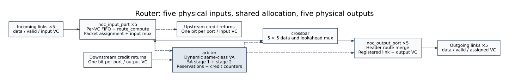

# `router_top` - `rtl/router_top.sv`



The whole router: five `noc_input_port`, one `arbiter`, one `crossbar`, five
`noc_output_port` (spec §4.6).

Nothing in this file is algorithmic - every decision is made by one of those
blocks. What this module owns is the **wiring**, and on a five-port VC router
the wiring is where an otherwise correct design silently breaks. The three
ways it breaks, and how each is defended against, are set out in §2.2–§2.4.

---

## 1. Ports and state

### 1.1 Parameters

| Name | Type | Default | Constraint | Meaning |
|---|---|---|---|---|
| `NUM_PORTS` | `int` | 5 | `-` | Fixed by the 5×5 crossbar: LOCAL, NORTH, EAST, WEST, SOUTH. |
| `FLIT_W` | `int` | 40 | `>= 16` (asserted) | Flit width, forwarded to `noc_input_port`, `noc_output_port` and `crossbar` so every payload bus in the router has the same width by construction. |
| `NUM_VC` | `int` | 4 | 2, 4 or 8 (asserted) | Virtual channels per port (v2 §1). Also fixes the `VC_W` sideband width (`in_vc_id`, `out_vc_id`, `st_out_vc`). |
| `LOCAL_IDX` | `int` | 0 | `-` | Index of the LOCAL port. |
| `FIFO_DEPTH` | `int` | 4 | power of two, `>= 2` (asserted) | Downstream input FIFO depth. **Must equal** `noc_input_port`'s FIFO and the arbiter's `DIR_CREDITS` (see §1.4) - it is passed straight through to both as `.DEPTH(FIFO_DEPTH)` and `.DIR_CREDITS(FIFO_DEPTH)`. |
| `LOCAL_CREDITS` | `int` | 4 | `-` | Network-interface receive buffer depth per VC; the reset value of `credit_count[LOCAL][*]`. |
| `CUR_X`, `CUR_Y` | `logic [2:0]` | `'0` | `-` | This router's coordinates, folded into every child `route_compute`. |
| `HAS_LOCAL`, `HAS_NORTH`, `HAS_EAST`, `HAS_WEST`, `HAS_SOUTH` | `bit` | `1'b1` | `-` | Per-direction presence. Index order matches the port table. |

The three numeric knobs are checked **at elaboration time**, each `$fatal` naming the parameter it rejects: `NUM_VC` must be
2, 4 or 8 so `VC_W = clog2(NUM_VC)` addresses it exactly, `FLIT_W` must be
at least 16, and `FIFO_DEPTH` must be a power of two ≥ 2. Without those a
bad `-G` override surfaces much later as an index quietly landing outside
its array instead of as the configuration error it is.

Presence is gathered into one unpacked array:

```systemverilog
localparam bit HAS_P [NUM_PORTS] = '{HAS_LOCAL, HAS_NORTH, HAS_EAST, HAS_WEST, HAS_SOUTH};
```

Unpacked so element 0 is LOCAL and the declaration reads in the same order as
the port table; a packed assignment pattern would put the first entry at the
MSB and silently invert the whole thing.

### 1.2 Port declaration

Direction is from the DUT's point of view.

| Signal | Width | Direction | Source → Destination | Working / description |
|---|---|---|---|---|
| `clk` | 1 | input | clock generator → all children, and → the four seam assertions | Single router-wide clock. |
| `rst_n` | 1 | input | reset generator → all children, `disable iff` | Synchronous, active low, matching `fifo.sv`. |
| `in_flit_data` | `NUM_PORTS × FLIT_W` | input | neighbour's `out_flit_data` (or the NI) → per-port tie → `noc_input_port.flit_data` | Incoming payload, indexed **per port**: index `p` is the link arriving *at* this port, so `in_flit_*[NORTH]` is what the north neighbour sent on *its* SOUTH output. Index `LOCAL` is the network interface. |
| `in_flit_valid` | `NUM_PORTS` | input | neighbour's `out_flit_valid` → tie (§2.4) → `noc_input_port.flit_valid` | Write enable for the corresponding input FIFO. |
| `in_vc_id` | `NUM_PORTS × VC_W` | input | neighbour's `out_vc_id` → tie → `noc_input_port.vc_id` | The `vc_id` sideband; selects which of the `NUM_VC` FIFOs the flit buffers into. |
| `out_flit_data` | `NUM_PORTS × FLIT_W` | output | `noc_output_port.flit_data` → downstream router's `in_flit_data[...]` or the NI | Registered payload leaving through each output port. |
| `out_flit_valid` | `NUM_PORTS` | output | `noc_output_port.flit_valid` → downstream `in_flit_valid` | Registered grant. |
| `out_vc_id` | `NUM_PORTS × VC_W` | output | `noc_output_port.vc_id` → downstream `in_vc_id` | Sideband travelling with the flit. |
| `credit_return_valid` | `NUM_PORTS × NUM_VC` | output | `noc_input_port.credit_return_valid` → the neighbour that drives `in_flit_*[p]` | One bit per VC (assumption D1: two VCs may free a slot in the same cycle). **Index `p` here refers to the incoming link**, so this signal is consumed by the neighbour *behind* port `p` - it is **not** the same port index as the `out_flit_*` group. |
| `ds_credit_valid` | `NUM_PORTS × NUM_VC` | input | downstream router's `credit_return_valid` (or the NI's) → `arbiter.ds_credit_valid` | `ds_credit_valid[o][k]` = "there is a free slot in the downstream router's input port `o`, VC `k`" - i.e. a credit for output `o`. Consumed only by the arbiter's credit counters. |

Every VC sideband above is `VC_W = (NUM_VC > 1) ? $clog2(NUM_VC) : 1` bits
wide - **2** at the default `NUM_VC = 4` - derived in this file
so the link sideband, the arbiter handshake and the input-port signals all
agree by construction.

**Port index and direction encoding (spec §2):**

| index | 0 | 1 | 2 | 3 | 4 |
|---|---|---|---|---|---|
| port | LOCAL | NORTH | EAST | WEST | SOUTH |
| dir (`4'b`) | `0000` | `0001` | `0010` | `0100` | `1000` |

A direction converts to an index by its set-bit position plus one; an index
converts back by `1 << index`. The arbiter, the crossbar and the tests all
use the same two functions (`dir_to_idx` in `rtl/arbiter.md`). An EAST
output of this router wires to the WEST input of the neighbour, which is why
"output port" and "input port" are separate namespaces that happen to share
these five indices.

### 1.3 Registers and state

`router_top` declares no registers of its own. All state lives in the
children; what it owns is a set of intermediate buses:

| Name | Width | Kind | Reset | Working / description |
|---|---|---|---|---|
| `HAS_P` | `NUM_PORTS` (unpacked `bit`) | `localparam` | n/a | Presence, in port-index order. Used by the input tie-offs and the two absent-port assertions. |
| `a_va_req` | `NUM_PORTS × NUM_VC` | wire (fold) | n/a | VA requests, input ports → arbiter, packed `[port][vc]`. |
| `a_va_req_out_port` | `NUM_PORTS × NUM_VC × 4` | wire (fold) | n/a | Requested output direction per (port, vc). |
| `a_va_req_single` | `NUM_PORTS × NUM_VC` | wire (fold) | n/a | "This is a one-flit packet" (HEAD_TAIL), which lets VA allocate without a split. |
| `a_va_gnt` | `NUM_PORTS × NUM_VC` | wire | n/a | VA grants to input FIFO identities. |
| `a_va_gnt_out_vc` | `NUM_PORTS × NUM_VC × VC_W` | wire | n/a | Actual allocated downstream VC returned with each grant. |
| `a_sa_req` | `NUM_PORTS × NUM_VC` | wire (fold) | n/a | SA requests (a flit is ready and has a VC). |
| `a_sa_req_out_port` | `NUM_PORTS × NUM_VC × 4` | wire (fold) | n/a | Output direction this SA request is asking for. |
| `a_sa_req_out_vc` | `NUM_PORTS × NUM_VC × VC_W` | wire | n/a | Stored assigned downstream VC; independent of input FIFO index. |
| `a_sa_req_last` | `NUM_PORTS × NUM_VC` | wire (fold) | n/a | "This is the packet's tail", which releases the row reservation. |
| `a_sa_gnt` | `NUM_PORTS × NUM_VC` | wire (fold) | n/a | Stage-2 grants, arbiter → input ports. |
| `a_sa_pick` | `NUM_PORTS × NUM_VC` | wire (fold) | n/a | Stage-1 picks; the input port uses it to select its pre-crossbar VC mux. |
| `a_xbar_sel` | `NUM_PORTS × 3` | wire | n/a | Arbiter → crossbar. `a_xbar_sel[o]` = input port index leaving through output `o`. |
| `a_st_valid` | `NUM_PORTS` | wire | n/a | Arbiter → crossbar, output ports, and the absent-port assertion. |
| `a_st_out_vc` | `NUM_PORTS × VC_W` | wire | n/a | Arbiter → output ports' `vc_id` sideband. |
| `xbar_in_data` / `xbar_out_data` | `NUM_PORTS × FLIT_W` | wire | n/a | Payload into and out of the crossbar. |
| `xbar_in_route_next` / `xbar_out_route_next` | `NUM_PORTS × 4` | wire | n/a | Lookahead route into and out of the crossbar. |

Per-instance fold locals (`l_*` inside `gen_in_port` / `gen_out_port`) are
listed in §2.2 - they exist because of the port-endpoint rule and are the
single largest source of lines in this file.

### 1.4 Parameter pass-through and the `FIFO_DEPTH` ↔ `DIR_CREDITS` invariant

```systemverilog
.DEPTH        (FIFO_DEPTH),   // noc_input_port: the buffer itself
.DIR_CREDITS  (FIFO_DEPTH),   // arbiter: a credit == a free slot in that FIFO
.FLIT_W       (FLIT_W),       // input port, output port, crossbar
.NUM_VC       (NUM_VC),       // input port, output port (arbiter gets it too)
```

A downstream credit **is** "a free slot in that downstream FIFO". If these
two ever disagree the credit loop over- or under-counts and the router
eventually either stalls (starved) or overflows a neighbour. The parameter is
passed through rather than redeclared so that they cannot drift; only
`LOCAL_CREDITS` is a separate number, because the NI's receive buffer is a
different buffer with a different depth.

The other overrides are required rather than decorative for the same kind
of reason: `noc_output_port` derives its own `VC_W` from `NUM_VC` to size
its `st_out_vc`/`vc_id` sideband, so left at its default it would keep a
2-bit sideband while the rest of the router carries `clog2(NUM_VC)` bits -
a mismatch that only shows up the moment a sweep leaves `NUM_VC = 4`.

---

## 2. RTL explanation

### 2.1 Structure

```
in_flit_* ──tie──▶ [noc_input_port ×5] ──fold──▶ arbiter ──▶ xbar_sel / st_valid / st_out_vc
                        │  ▲                          │                              │
                        │  └──── sa_gnt, sa_pick, va_gnt ◀───────────────────────────┤
                        ▼                                                         ▼
                  xbar_in_data/route ◀──────────────────────────▶ [crossbar] ──▶ [noc_output_port ×5] ──▶ out_flit_*
                        │                                                                │
                        └── credit_return_valid ──▶ neighbour                       ds_credit_valid ◀── neighbour
```

Two generate loops, `gen_in_port` and `gen_out_port`, each instantiating
five children, plus single instances of `arbiter` and `crossbar`.

### 2.2 Fold directionality (the first subtle thing)

The arbiter speaks **packed** per-port buses (`[NUM_PORTS-1:0][NUM_VC-1:0]…`)
because it sees all five ports at once. A `noc_input_port` sees one port and
speaks **per-VC vectors**, including two *unpacked* arrays for the request
fields (`l_va_req_out_port[NUM_VC]`, `l_sa_req_out_port[NUM_VC]`).

Something has to translate between those shapes, and doing it in one
direction only would leave half the signals undriven. Every fold below is
therefore written explicitly, in the correct direction, next to the signal it
moves - there is no implicit conversion anywhere:

```systemverilog
// instance -> arbiter
assign a_va_req[p]      = l_req_va;
assign a_sa_req[p]      = l_req_sa;
assign a_sa_req_last[p] = l_sa_req_last;
// arbiter -> instance
assign l_va_gnt  = a_va_gnt[p];
assign l_sa_gnt  = a_sa_gnt[p];
assign l_sa_pick = a_sa_pick[p];
```

The two unpacked per-VC request arrays cannot be assigned to each other at
all - an unpacked array and a packed slice are different types - so they are
moved one VC at a time inside a nested generate, at a constant index:

```systemverilog
for (genvar v = 0; v < NUM_VC; v++) begin : gen_vc_fold
  assign a_va_req_out_port[p][v] = l_va_req_out_port[v];
  assign a_sa_req_out_port[p][v] = l_sa_req_out_port[v];
  assign a_sa_req_out_vc[p][v]   = l_sa_req_out_vc[v];
end
```

The grant sideband travels in the reverse direction using a packed
`l_va_gnt_out_vc = a_va_gnt_out_vc[p]` connection. Each input VC captures its
assigned output VC at VA. The public router and mesh link interfaces and the
flit format are unchanged. The previous VC-matched behavior is superseded by
[dynamic allocation](arbiter.md).

A simulation-only seam scoreboard records all live assignments, including
VCs without an active flit. It asserts one owner per output resource, correct
SA port/VC mapping, and matching transmission sidebands. These checks are
excluded from synthesis; they add no datapath stage.

### 2.3 Port endpoints (the second subtle thing)

A module instance may only be connected to a plain signal or to a whole
array. An element select used as the connection - `u(.in(sig[i]))` - does not
see writes after time 0 and the connection silently freezes at its initial
value.

So **every instance is wired to generate-scope local signals**, and those
locals are folded into the shared buses with a continuous assign at a
*constant* genvar index:

```systemverilog
logic [FLIT_W-1:0] l_flit_data;
assign l_flit_data = HAS_P[p] ? in_flit_data[p] : '0;   // RHS index: legal (continuous assign, constant genvar)
noc_input_port u_in_port (.flit_data(l_flit_data), ...); // endpoint: a plain signal
assign xbar_in_data[p] = l_st_flit_data;                 // fold at a constant index
```

Note that reading `in_flit_data[p]` on the *right* of a continuous assign is
fine - `p` is a genvar, so the index is fixed at elaboration, and the
expression is not a port connection. The rule is about endpoints, not about
indices in general. The same rule is why the testbenches are written the way
they are: see "Testbench Wiring Rules" in `README.md`.

`IS_LOCAL_PORT(p == LOCAL_IDX)` is a generate constant that folds to `1'b0`
or `1'b1` per instance at elaboration, which is what tells `route_compute`
whether the header on `data_out` already carries a route (directional ports)
or has to compute one from the destination fields (LOCAL).

### 2.4 Edge-of-mesh tie-off (the third subtle thing)

```systemverilog
assign l_flit_data  = HAS_P[p] ? in_flit_data[p]  : '0;
assign l_flit_valid = HAS_P[p] ? in_flit_valid[p] : 1'b0;
assign l_vc_id      = HAS_P[p] ? in_vc_id[p]      : '0;
```

A router on the boundary has no neighbour on some sides. An undriven
`flit_valid` would look like a stream of flits and fill the FIFO with X/0, so
the incoming side is tied (spec §4.6). **Both halves matter**: the tie keeps
the input defined, and the assertion at the bottom says the tie should never
be load-bearing.

Note what is *not* tied: the **outgoing** side. Gating an absent port's
`out_flit_valid` would hide a routing bug where the assertion would catch it.
This is stated explicitly in the file header because it is the edit that
looks most reasonable and is wrong.

### 2.5 Children instantiation

- **`noc_input_port` ×5** - one per link, wired in §2.3–§2.4. Carries
  `.FLIT_W(FLIT_W)`, `.DEPTH(FIFO_DEPTH)`, `.NUM_VC(NUM_VC)`,
  `.CUR_X`/`.CUR_Y`, and the generate constant
  `.IS_LOCAL_PORT(p == LOCAL_IDX)` that decides whether the header arrives
  with a route already in it.
- **`arbiter`** - every port is a whole packed bus, so each connection is a
  single line with no index at the endpoint. `.DIR_CREDITS(FIFO_DEPTH)`,
  `.LOCAL_CREDITS(LOCAL_CREDITS)` and `.NUM_VC(NUM_VC)` come from §1.4. It
  is the only child that sees `ds_credit_valid`.
- **`crossbar`** - `.FLIT_W(FLIT_W)`, fed from the per-input-port folds and
  the arbiter's selection, all whole buses.
- **`noc_output_port` ×5** - same local-then-fold pattern as the inputs,
  with `.FLIT_W(FLIT_W)` and `.NUM_VC(NUM_VC)` (§1.4).

### 2.6 Assertions - cross-block seams only

Each child already checks everything it can see by itself. What is left is
exactly what sits between two children, which neither can check without
reaching into the other. Four, one per `p`, all `@(posedge clk) disable iff
(!rst_n)`:

| Seam | Property | Why it lives here |
|---|---|---|
| **6** | `a_sa_gnt[p] == (a_sa_gnt[p] & a_sa_pick[p])` | Grant implies pick. If a grant could arrive without a pick, the flit on the crossbar would be a different VC's flit than the one the arbiter thinks it switched - **both blocks individually consistent and the packet still corrupted**. Stated bitwise rather than as `\|gnt \|-> \|pick` because the rule is per VC: a port could pick VC0 and grant VC1 and still satisfy the weaker form. The arbiter asserts this too, but from its side; asserting it here confirms the *connection*. |
| - | `!HAS_P[p] \|-> !(\|credit_return_valid[p])` | No credit on a link that does not exist. `credit_return_valid` comes from the input port's own fetch, and a fetch can only happen if `flit_valid` reached the FIFO - and that is tied off. Structurally impossible, which is exactly why it is worth stating: if someone later removes the tie to "simplify" the edge ports, this fires instead of the symptom appearing as phantom credits in a neighbour. |
| - | `!HAS_P[p] \|-> !a_st_valid[p]` | Nothing routed to a port with no neighbour. XY with an in-range destination never selects an absent direction, so a grant on one is a **routing bug, not an edge case to be handled**. The output is deliberately not gated (§2.4) - an actual `out_flit_valid` here is the bug being looked for. |
| - | `a_sa_gnt[p] == (a_sa_gnt[p] & a_sa_req[p])` | The arbiter grants only what that port asked for. Both halves live inside the arbiter, but the two signals cross a generate fold on their way here, and a fold pointing at the wrong port would make port *p*'s grant answer port *q*'s request - each block individually consistent while the pair is crossed. |

---

## 3. Testing explanation

Two benches exercise this file, at two different scales.

### 3.1 `tb/tb_router_top.sv` - a single router

**Run:** `make TOP=router_top sim` → **ALL 104 CHECKS PASSED** (104 checks
across T1–T9 plus the edge-of-mesh case).

What it covers:

- **End-to-end through one router** - injection at LOCAL, VA allocation, SA
  grant, crossbar transfer, ejection or link departure. The checks follow a
  packet through all five stages rather than probing each block separately,
  which is what makes this the first test that can catch a *seam* bug.
- **Both VCs** - that two packets on different VCs coexist in the input
  FIFOs, are granted independently, and do not corrupt each other's
  `vc_id` sideband.
- **Credit flow** - held-credit modelling (the bench's TX driver may not
  hold more than `FIFO_DEPTH` uncredited flits in a `(port, VC)` - exactly
  what a real neighbour does - and the downstream pipe reproduces spec
  §6's loop, returning a credit two cycles after the grant: flit on the
  wire at `g+1`, credit visible at `g+2`), including T7, which switches
  the pipe off to empty a pool and then brings it back for the recovery
  case.
- **Route / merge** - that a header's `[13:10]` comes out of the router
  holding *this* router's lookahead, and that BODY/TAIL payloads are
  bit-identical on the way through.
- **Edge-of-mesh routing (E1)** - the router under test is instantiated
  with **all five ports present**, so what this case checks is the half of
  §2.4 that still applies: an in-range destination never selects an absent
  direction. Two packets bound for (2,1) and (1,0) leave via EAST and
  NORTH. The `HAS_P` ties and the two `!HAS_P` seam properties cannot fire
  here at all - `tools/assert_neg.sh` proves those against the chain bench,
  where an absent port actually exists (§3.3).
- **The four seam assertions in §2.6 are live for the whole run** - two of
  them vacuous in this all-ports-present configuration (§3.3).

### 3.2 `tb/tb_router_chain.sv` - three routers

**Run:** `make TOP=router_chain sim` → **ALL 1640 CHECKS PASSED** at default NUM_VC=4, including the new dynamic
multi-hop tests and per-link packet monitor.

A chain of A -EAST→ B -EAST→ C, with `HAS_WEST = 0` on A, `HAS_EAST = 0` on
C and `HAS_NORTH`/`HAS_SOUTH = 0` on all three. This is where:

- the merged route field is **consumed** by the next router rather than
  merely observed (T10a–T10d),
- the credit loop across a real link is measured (section-6 test: 16 flits at
  one flit per cycle, `max_gap == 1` on A→B, B→C and ejection),
- random traffic (~36 packets, both VCs, lengths 1–6) is checked by an
  end-to-end scoreboard (T11).

See `docs/tb/tb_router_chain.md` for the full test list.

### 3.3 Assertion coverage

All four seam properties are live in both benches. `tools/assert_neg.sh`
proves one of them actually fires, with `--assert` **on**:

```
%Error: router_top.sv:480: Assertion failed in TOP.tb_router_chain.u_a.gen_top_assert[1]:
        router_top: port 1 has no link but returned credits 1111
```

That case mutates the per-port credit fold to a constant and runs against the
*chain* bench, because the two `HAS_P`-gated properties are **vacuous** under
`tb_router_top` - that bench ties all five ports present. The chain is the
only configuration in which an absent port exists, which is worth knowing
when adding future assertions of this kind.

### 3.4 Mutation sanity

`tools/mutate_all.sh` and `tools/mutate_out.sh` run against `tb_router_top`
and, with `--assert` off, kill every mutation - all eight are **killed**.

The clean run reports `ALL 104 CHECKS PASSED`. A mutant run reports a
*different* denominator, and the difference is itself information: a great
many of this bench's checks sit behind `if (rx_n() >= k)` guards (§3.1), so
a mutation that makes packets vanish takes those checks out of the count
with them. A mutation that only changes arbitration order leaves every
packet in place and moves a single check; the one that breaks the input
port's grant/fetch ordering stalls the mesh so hard that fewer than half the
bench's checks are ever reached.

| Mutation | File | Result |
|---|---|---|
| XY direction inverted | `route_compute.sv` | killed - 13/103 |
| stage-2 round-robin ignores its pointer | `arbiter.sv` | killed - 1/104 |
| grant wins over fetch (spec §9) | `noc_input_port.sv` | killed - 16/49 |
| stage-1 ignores the credit pool | `arbiter.sv` | killed - 2/104 |
| data mux reads the port next to the winner | `crossbar.sv` | killed - 30/103 |
| header route field merged with the wrong direction | `noc_output_port.sv` | killed - 3/104 |
| route merge never happens | `noc_output_port.sv` | killed - 3/104 |
| route merge applied to every flit | `noc_output_port.sv` | killed - 2/104 |

The first six live in `tools/mutate_all.sh` (6 of 6 killed), the last two
in `tools/mutate_out.sh` (2 of 2 killed).

`git diff rtl/` is clean after the suite runs - every script restores its
backup, and a final sweep re-verifies all eight RTL tops lint clean under
`-Wall`.
